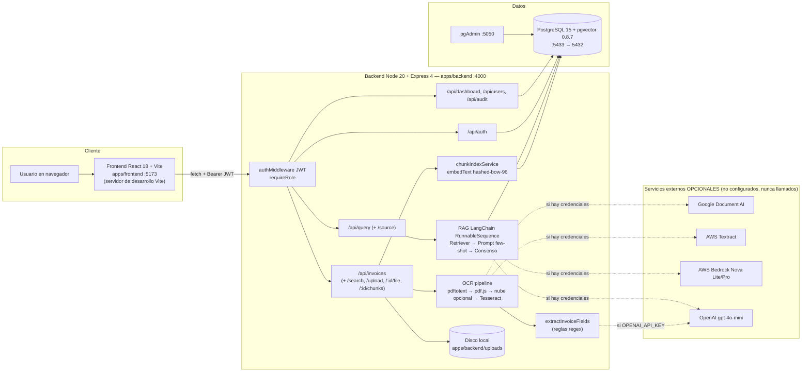
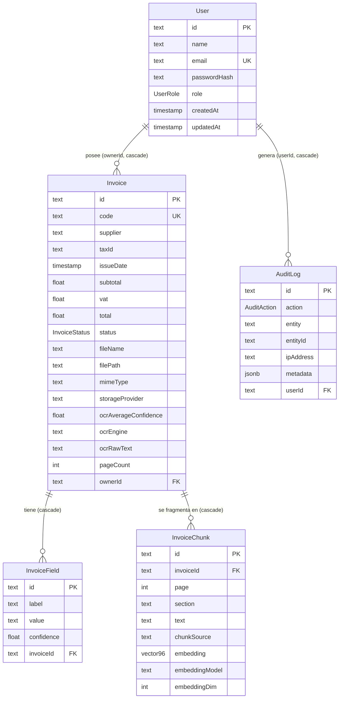

# SmartBills Cleaner — Auditoría técnica y preparación para la reunión con el director

Fecha de la auditoría: 24 de octubre de 2026.
Rama inspeccionada: `feature/s4-metricas` (commit `b9c8ef9`). Contenedores Docker en ejecución desde hace 8 días.

## Cómo se obtuvo la evidencia

| Fuente | Qué se hizo | Limitación |
|---|---|---|
| Chat anterior de Cursor (17 sep – 16 oct 2026) | Se leyeron todos los mensajes del usuario y las respuestas clave del agente | El anteproyecto PDF (`PMV-Proyecto-Integrador-SmartBillsCleaner.pdf`) **no está** en el repositorio; solo se cita en `docs/output/marco_teorico_smartbills_cleaner.md` |
| Código fuente | Lectura completa de backend, frontend, migraciones, Docker y scripts | — |
| Base de datos real (Postgres en Docker) | Solo consultas `SELECT`, `\d`, `\dx` y `EXPLAIN` | No se escribió nada |
| Pruebas | `npm test` dentro del contenedor backend: **24/24 OK** (ejecutado hoy) | Son unitarias; no hay pruebas de integración, E2E ni de frontend |
| Verificación funcional | Llamadas directas a `searchInvoicesHybrid` y `queryInvoices` dentro del contenedor (solo lectura) | No se usó la UI para no crear registros `LOGIN` en `AuditLog` |
| Jira y Confluence | No hay acceso | Lo que se dice de Jira sale de `docs/sprint-4/jira-backlog.md` y del chat |

Etiquetas de estado usadas en todo el documento:

- **VERIFICADO**: implementado y comprobado hoy, ya sea ejecutándolo o consultando la base de datos.
- **IMPLEMENTADO, NO VERIFICADO HOY**: el código existe, pero no se ejecutó en esta auditoría.
- **PARCIAL**: el código existe, pero no cumple todo el criterio de aceptación.
- **DISEÑADO, NO IMPLEMENTADO**: aparece en documentación o backlog, pero no en el código.
- **DESCONOCIDO**: no hay evidencia suficiente.

---

## 1. Resumen ejecutivo

**Qué es.** SmartBills Cleaner es una aplicación web para cargar facturas (PDF o imagen), extraer sus datos con OCR, validarlos manualmente y consultarlos de dos formas: con una búsqueda híbrida (filtros SQL más ranking vectorial) y con preguntas en lenguaje natural respondidas mediante RAG con citas a factura y página.

**Estado real en una frase.** Es un MVP que funciona de punta a punta **en local, con Docker**, y no está desplegado en ningún entorno remoto. Los componentes de IA existen y están conectados, pero hoy se ejecutan en su **modo local de respaldo**:

- Los embeddings son un hash de palabras (`hashed-bow-96-v2`), no un modelo semántico.
- El generador del RAG es extractivo y local; no hay un LLM real porque no hay credenciales de Bedrock ni de OpenAI.
- El OCR en la nube (Document AI y Textract) está programado, pero nunca se ha llamado.

**Lo más importante para mañana:**

1. Todo arranca y funciona en local. Lo verifiqué hoy: API sana, frontend responde, 4 migraciones aplicadas, pgvector 0.8.7, 26 fragmentos (chunks) vectorizados y 24/24 pruebas unitarias en verde.
2. Hay **defectos verificados** que debes conocer antes de que te los encuentren:
   - La búsqueda semántica ordena mal sin filtros: "energia electrica" no pone a Enel primero.
   - `parseMoney` trunca montos colombianos como `$ 139.820` y los convierte en `139.82`.
   - La "confianza OCR" puede ser 100 % con un proveedor mal leído.
   - Los archivos subidos se sirven **sin autenticación** en `/uploads`.
3. La métrica "RAGAS" es una **implementación propia aproximada**, no la librería RAGAS. Su fidelidad vale 1.0 casi por construcción, porque las citas se depuran antes de medirlas.
4. No hay despliegue, CI/CD ni infraestructura como código. La razón verificable es que nunca se configuraron: no existen archivos de ese tipo en el repositorio.
5. En GitHub, `main` ya incluye el Sprint 4 hasta la documentación (PR #1 fusionado, commit `3f67f94`). El commit de métricas `b9c8ef9` está solo en `feature/s4-metricas`. Tu `main` local está desactualizado.

---

## 2. Fase 1 — Propósito de la tesis

### 2.1 Qué está documentado y qué es inferido

| Elemento | ¿Documentado? | Dónde |
|---|---|---|
| Problema | Sí | `docs/output/marco_teorico_smartbills_cleaner.md` (Introducción), `docs/abstraccion_ihc_smartbills.md`, `README.md` |
| Solución propuesta (OCR, vectorización, búsqueda semántica, consultas NL con referencias) | Sí | Marco teórico, "Nota de alcance" |
| Arquitectura por capas (presentación, servicios, IA) | Sí | Marco teórico, sección "Arquitectura del sistema" |
| Metodología de desarrollo: Scrum | Sí | Marco teórico, Scrum Guide; chat (sprints 3 y 4, Jira SBC-*) |
| Pregunta de investigación | **No encontrada** | Probablemente está en el anteproyecto PDF, que no está en el repositorio |
| Objetivo general y objetivos específicos | **No encontrados textualmente** | Igual que la anterior |
| Hipótesis o métricas de éxito académicas | **No encontradas** | Los criterios de aceptación de Jira (p95 < 4 s, Top-K = 5) son de producto, no de investigación |
| Instrumentos de investigación con usuarios | Sí, como borradores | `docs/instrumento_investigacion_usuarios_smartbills.md`, `docs/encuesta_smartbills_lista_para_llenar.md`, `outputs/…xlsx` |

> Acción para esta noche: abre el anteproyecto y copia textualmente la pregunta y los objetivos. No los improvises en la reunión.

### 2.2 Problema (documentado)

Gestionar facturas a mano (PDF o imagen) implica leer, transcribir y verificar proveedor, NIT, fecha, subtotal, IVA y total. Eso consume tiempo, genera errores y deja poca trazabilidad. Además, consultar el histórico ("¿cuánto pagué de energía?") exige buscar documento por documento.

### 2.3 Solución propuesta y en qué se diferencia

La diferencia con un gestor documental o un OCR convencional es la **cadena completa con evidencia verificable**:

1. OCR por capas, con nube opcional.
2. Extracción de campos con un puntaje por campo.
3. Revisión humana de los campos extraídos.
4. Fragmentación por página y vectorización.
5. Consulta en lenguaje natural que **cita la factura y la página** (`[Factura X, pág. N]`). Además, el sistema **elimina citas inventadas** (`verifyAnswerCitations` en `apps/backend/src/services/rag/citations.js`).

### 2.4 Alcance actual y limitaciones (verificado en el código)

- Un solo nodo local con Docker Compose. No hay multiempresa, colas ni workers.
- El OCR es síncrono dentro de la petición HTTP de carga. Los estados `QUEUED` y `PROCESSING` del enum no se usan en el flujo real.
- Los embeddings no son semánticos (ver sección 6).
- El generador del RAG es local y extractivo. Bedrock y OpenAI solo se activan con credenciales que hoy no existen.
- La evaluación es pequeña: 5 casos RAGAS (`apps/backend/src/services/rag/evalCases.js`) sobre 14 facturas, 6 de ellas sintéticas.

### 2.5 Decisiones importantes y su porqué (del chat y del código)

| Decisión | Justificación registrada | Evidencia |
|---|---|---|
| Stack Node/Express/Prisma/React-Vite en lugar de Django/Next.js del anteproyecto | Cambio tecnológico que no altera la arquitectura por capas | Marco teórico, sección "Arquitectura" |
| OCR local por defecto (pdftotext, pdf.js, Tesseract) y nube opcional | Demo sin costos ni credenciales; la nube no debe romper la carga si falla | `ocrEngine.js` y `cloudOcr.js`; chat del 9 oct |
| Document AI antes que Textract y descartar OCR.space | Document AI ofrece un parser de facturas y cupo gratuito; OCR.space solo devuelve texto | Chat del 9 oct; `OCR_CLOUD_ORDER` |
| pgvector dentro de Postgres en vez de una base vectorial aparte | Un solo motor, filtros SQL y orden vectorial en la misma consulta | Migración `202610080001_pgvector_embeddings` |
| Embedding hash de 96 dimensiones en vez de SBERT | Ligero, sin dependencias ni GPU, "no estresar el sistema" | Chat del 8 oct; `utils/embeddings.js`. Spike HF-ONNX pendiente en `jira-backlog.md` |
| Para SBC-25 (búsqueda) no usar un LLM de Hugging Face ni de Bedrock | La historia pide filtrar y ordenar, no generar texto | Chat del 8 oct |
| `RunnableSequence` de LangChain 1 en lugar de `RetrievalQAChain` | `RetrievalQAChain` ya no existe en LangChain 1 | Chat del 8 oct; `rag/chain.js` |
| "Consenso" entre modelo base y ajustado | Lo pedía la subtarea de Jira; gana el candidato más fiel a las citas | `rag/consensus.js` |

### 2.6 Qué falta validar académicamente

- La calidad de extracción del OCR sobre un **conjunto real etiquetado**: precisión por campo (NIT, total, fecha, proveedor).
- La calidad de recuperación con embeddings **reales**, comparada con el hash actual.
- La calidad de las respuestas con un **LLM real** y con RAGAS "de verdad" (librería oficial o un juez LLM).
- La usabilidad: los instrumentos de entrevista y encuesta existen, pero no hay resultados en el repositorio.

### 2.7 Presentación de 2 minutos

> "SmartBills Cleaner ataca un problema muy concreto: las facturas llegan en PDF o imagen y alguien tiene que leerlas, transcribir proveedor, NIT, fechas y montos, y después buscarlas a mano cuando necesita responder algo como '¿cuánto pagué de energía en marzo?'. Mi propuesta es una aplicación web que automatiza esa cadena: cuando cargo una factura, el sistema extrae el texto con OCR (primero el texto nativo del PDF y, si es un escaneo, Tesseract; hay conectores opcionales a Google Document AI y AWS Textract), identifica los campos clave con reglas, me deja validarlos y corregirlos, y guarda todo en PostgreSQL.
>
> Además, cada página se convierte en un fragmento vectorizado con pgvector. Eso habilita dos formas de consulta: una búsqueda híbrida que combina filtros SQL por proveedor, fechas y montos con un ranking vectorial, y preguntas en lenguaje natural que se responden con un pipeline RAG sobre LangChain. La diferencia frente a un chatbot es que cada respuesta cita la factura y la página de donde salió, y el sistema elimina cualquier cita que no corresponda a un fragmento recuperado.
>
> Hoy el sistema funciona de punta a punta en local con Docker y tiene 24 pruebas unitarias en verde. Siendo honesto con el estado: el embedding es todavía un vector de hash ligero y no un modelo semántico, el generador del RAG corre en modo local porque no tengo credenciales de Bedrock, y la aplicación no está desplegada. Los siguientes pasos son reemplazar el embedding por un modelo multilingüe real, evaluar con un conjunto de facturas reales etiquetadas y desplegar una versión de pruebas."

---

## 3. Fase 2 — Arquitectura y estructura del repositorio

### 3.1 Diagrama de arquitectura (solo componentes con evidencia)



Pendiente de verificar: no existe ningún entorno remoto, dominio, HTTPS, CI/CD ni monitoreo. Por eso no aparecen en el diagrama.

### 3.2 Cómo explicarlo en una pizarra

Dibuja cuatro cajas de izquierda a derecha:

1. **Navegador (React).** Pantallas de login, dashboard, carga, facturas y consultas. Guarda el token JWT en `localStorage` y lo envía en cada petición.
2. **API (Express).** Tiene una "puerta" (`authMiddleware`) y detrás cinco grupos de rutas. Dentro hay dos "motores":
   - **Ingesta:** OCR, luego extracción de campos y luego indexación vectorial.
   - **Consulta:** búsqueda híbrida y RAG.
3. **Postgres con pgvector.** Guarda los datos estructurados (usuarios, facturas, campos y auditoría) y los vectores (chunks) en la **misma** base de datos.
4. **Nubes opcionales** con línea punteada. Se usan solo si hay llaves; si fallan, el flujo sigue con el camino local.

### 3.3 Responsabilidad de cada componente

| Componente | Responsabilidad | Recibe → entrega | Habla con | Archivo |
|---|---|---|---|---|
| Arranque de la API | Monta CORS, JSON, `/uploads` estático, las rutas y el manejador de errores. Al iniciar, ejecuta el seed e indexa los chunks faltantes | Petición HTTP → JSON | Todas las rutas y Prisma | `apps/backend/src/server.js` (`bootstrap`, l. 50-57) |
| Configuración | Lee las variables de entorno con valores por defecto | `process.env` → objeto `env` | Todo el backend | `src/config/env.js`, `src/config/prisma.js` |
| Autenticación | Verifica el JWT, carga el usuario desde la base de datos y comprueba el rol | Header `Authorization` → `req.user` o 401/403 | Prisma (`User`) | `src/middleware/auth.js`, `src/utils/tokens.js` |
| Rutas de facturas | Listar, buscar, ver, servir el archivo, ver chunks, subir, editar y borrar | HTTP → JSON | OCR, índice, búsqueda, auditoría | `src/routes/invoiceRoutes.js` |
| OCR | Obtiene el texto por página con la cascada local o la nube | Ruta de archivo + MIME → `{engine, pageCount, pages[]}` | Binarios `pdftotext`, `pdftoppm`, `tesseract`; nube | `src/services/ocr/ocrEngine.js`, `cloudOcr.js` |
| Extracción | Encuentra proveedor, NIT, fecha, montos y número con regex, y asigna un puntaje por campo | Texto → campos + `averageConfidence` + `missingCore` | OpenAI (opcional) | `src/services/ocr/extractInvoiceFields.js`, `processInvoiceDocument.js` |
| Índice vectorial | Convierte las páginas en chunks con embedding y los reemplaza en la base de datos | `invoiceId` → filas `InvoiceChunk` | Prisma `$executeRaw` | `src/services/chunkIndexService.js`, `vectorStore.js`, `utils/embeddings.js` |
| Búsqueda híbrida | Aplica filtros SQL y luego el ranking vectorial | Query string → facturas con `score` | Prisma y pgvector | `src/services/invoiceSearchService.js` |
| RAG | Recupera el Top-5, arma el prompt few-shot, genera dos candidatos, elige uno y verifica las citas | Pregunta + filtros → respuesta, citas y consenso | pgvector, Bedrock y OpenAI (opcionales) | `src/services/rag/*.js`, `queryService.js` |
| Auditoría | Inserta eventos | Acción → fila `AuditLog` | Prisma | `src/services/auditService.js` |
| Cliente API (frontend) | Envuelve `fetch`, adjunta el token y traduce errores | Llamadas → JSON o `Error` | Backend | `apps/frontend/src/api/client.js` |
| Estado de sesión (frontend) | Contexto con el usuario, login, logout y `me()` | Token → `user` | Cliente API | `apps/frontend/src/context/AuthContext.jsx` |
| Ruteo (frontend) | Rutas públicas y rutas `/app/*` protegidas | URL → página | `ProtectedRoute` | `apps/frontend/src/App.jsx` |

### 3.4 Árbol representativo

```text
smartbills/
├── docker-compose.yml          # postgres(pgvector), pgadmin, backend, frontend
├── package.json                # monorepo npm workspaces (apps/backend, apps/frontend)
├── .env.example                # variables raíz (sin secretos reales)
├── apps/
│   ├── backend/
│   │   ├── Dockerfile          # node:20 + tesseract spa/eng + poppler-utils
│   │   ├── .env.example
│   │   ├── prisma/
│   │   │   ├── schema.prisma   # modelos User, AuditLog, Invoice, InvoiceField, InvoiceChunk
│   │   │   ├── migrations/     # 4 migraciones (init, chunks, ocr_metadata, pgvector)
│   │   │   └── seed.js
│   │   ├── scripts/            # ragas-eval, perf-benchmark, reportes, evidencia Jira
│   │   ├── uploads/            # archivos subidos (ignorado por git)
│   │   └── src/
│   │       ├── server.js       # PUNTO DE ENTRADA
│   │       ├── config/         # env.js, prisma.js
│   │       ├── middleware/     # auth.js
│   │       ├── routes/         # auth, dashboard, users, audit, invoices, query
│   │       ├── services/
│   │       │   ├── ocr/        # ocrEngine, cloudOcr, extractInvoiceFields, processInvoiceDocument (+ tests)
│   │       │   ├── rag/        # chain, retriever, retrieve, prompt, generators, consensus, citations, ragasMetrics
│   │       │   ├── chunkIndexService.js, vectorStore.js, invoiceSearchService.js, queryService.js
│   │       │   └── seedService.js, semanticDemoInvoices.js, auditService.js, invoiceDocument.js
│   │       └── utils/          # embeddings, tokens, paths, http
│   └── frontend/
│       ├── Dockerfile          # node:20-alpine, ejecuta `vite` en modo dev
│       └── src/
│           ├── main.jsx        # PUNTO DE ENTRADA UI
│           ├── App.jsx         # rutas
│           ├── api/client.js
│           ├── context/AuthContext.jsx
│           ├── layout/AppLayout.jsx
│           ├── components/     # AdvancedSearchForm, InvoiceEditor, DocumentPreview, KpiCard, BarChartCard...
│           └── pages/          # Landing, Login, Register, Dashboard, Invoices, Upload, Consult, Users, Audit, Settings
└── docs/                       # marco teórico, sprint-4 (informes, métricas, capturas), presentaciones, evidencia Jira
```

### 3.5 Archivos clave

| Archivo o carpeta | Responsabilidad | Elementos principales | Dependencias | Estado |
|---|---|---|---|---|
| `apps/backend/src/server.js` | Entrada de la API | `bootstrap`, manejador de errores, montaje de rutas | Express, `cors`, todas las rutas | VERIFICADO (API en `:4000`, `/api/health` responde ok) |
| `apps/backend/prisma/schema.prisma` + `migrations/` | Esquema de datos | 5 modelos y 3 enums | Prisma 5.22 | VERIFICADO: las 4 migraciones están aplicadas en la base de datos |
| `src/routes/invoiceRoutes.js` | CRUD de facturas, carga y búsqueda | `POST /upload`, `GET /search`, `PUT /:id`, `DELETE /:id` | Multer, OCR, índice | VERIFICADO (la búsqueda se ejecutó hoy) |
| `src/services/ocr/*` | OCR y extracción | `extractDocumentPages`, `tryCloudOcr`, `extractInvoiceFields` | pdftotext, Tesseract, AWS SDK | Local: VERIFICADO (hay facturas `pdftotext` y `tesseract` en la base de datos). Nube: NO VERIFICADO (sin credenciales) |
| `src/utils/embeddings.js` | Embedding | `embedText`, `tokenize`, `cosineSimilarity` | — | VERIFICADO, con limitación de calidad (sección 6) |
| `src/services/vectorStore.js` | SQL crudo de pgvector | `replaceInvoiceChunks`, `searchSimilarChunks` | `$executeRaw` y `$queryRaw` | VERIFICADO |
| `src/services/rag/*` | Pipeline RAG | `createRetrievalQaChain`, `InvoiceChunkRetriever`, `generateWithConsensus`, `verifyAnswerCitations` | `@langchain/core`, `@langchain/aws` | VERIFICADO en modo local. Bedrock y OpenAI: NO VERIFICADO |
| `apps/frontend/src/pages/*` | Pantallas | `InvoicesPage`, `UploadPage`, `ConsultPage`… | `api/client.js` | IMPLEMENTADO. Hay capturas en `docs/sprint-4/capturas/`; la UI no se recorrió hoy |
| `docker-compose.yml` | Infraestructura local | 4 servicios | Docker | VERIFICADO (4 contenedores "Up 8 days") |
| `apps/backend/scripts/*` | Evaluación y métricas | `ragas-eval.mjs`, `perf-benchmark.mjs` | API viva | Ejecutados el 15 oct (JSON en `docs/sprint-4/evidencia/`); no se repitieron hoy |

### 3.6 Arranque, inicialización y ejecución

- **Dónde arranca:** el backend en `apps/backend/src/server.js`. El contenedor ejecuta `prisma generate`, luego `prisma migrate deploy` y luego `node src/server.js` (`apps/backend/Dockerfile`, línea 23). El frontend arranca en `apps/frontend/src/main.jsx` (`BrowserRouter`, `AuthProvider`, `App`).
- **Inicialización:** `bootstrap()` ejecuta `seedDatabase()` (crea usuarios y facturas demo si la base está vacía, y asegura las facturas `DEMO-VEC-*`) y `ensureInvoiceChunksIndexed()` (reindexa facturas sin chunks o con un modelo de embedding desactualizado). Después escucha en el puerto.
- **Rutas e interfaces:** backend en `server.js` (líneas 30-35) y `routes/*.js`; frontend en `App.jsx` y `api/client.js`.
- **Lógica de negocio:** en `services/` (OCR, extracción, índice, búsqueda y RAG). Ojo: también hay lógica dentro de `routes/invoiceRoutes.js` (código de factura, respaldo cuando falla el OCR, recálculo de confianza).
- **Acceso a datos:** Prisma Client, con un singleton en `config/prisma.js`. Para vectores se usa SQL crudo en `vectorStore.js`, porque Prisma no soporta el tipo `vector`: el campo está declarado como `Unsupported("vector")`.
- **Entornos:** `.env` en la raíz (lo lee Docker Compose; está en `.gitignore`), y `apps/backend/.env.example` y `apps/frontend/.env.example` como plantillas. No hay separación dev, test y prod.
- **Ejecutar en desarrollo:**
  - Con Docker, que es el camino verificado: `docker compose up -d --build` en la raíz.
  - Sin Docker: Postgres con pgvector en `:5433`, `cp apps/backend/.env.example apps/backend/.env`, `npm install`, `npm run db:generate`, `npx prisma migrate deploy --schema apps/backend/prisma/schema.prisma` y `npm run dev`. Sin `pdftotext` ni `tesseract` en el Mac (no están instalados), el OCR cae a pdf.js y tesseract.js.
- **Relación entre aplicaciones:** monorepo con npm workspaces. El frontend solo conoce la URL de la API (`VITE_API_URL`) y no comparte código con el backend.

---

## 4. Fase 3 — Base de datos

### 4.1 Acceso y conexión

| Aspecto | Valor verificado |
|---|---|
| Motor | PostgreSQL 15 con la extensión `vector` 0.8.7 (imagen `pgvector/pgvector:pg15`) |
| Driver/ORM | Prisma 5.22 (`@prisma/client`). SQL crudo para los vectores |
| Variable | `DATABASE_URL`, que contiene usuario, contraseña, host, puerto, base de datos y `schema=public` |
| Dentro de Docker | Host `postgres`, puerto `5432`. La URL está en `docker-compose.yml`, servicio `backend` |
| Desde tu Mac | Host `localhost`, puerto **5433** (mapeado `5433:5432`). Plantilla en `apps/backend/.env.example` |
| Usuario y base de datos | Definidos en `docker-compose.yml` (`POSTGRES_DB`, `POSTGRES_USER`, `POSTGRES_PASSWORD`). Son valores de desarrollo escritos en el archivo; no los repito aquí |
| pgAdmin | `http://localhost:5050`, con credenciales `PGADMIN_DEFAULT_*` del `.env` o los valores por defecto del compose |
| Entornos | Solo existe local/dev. No hay base de datos de pruebas ni de producción |

**Comandos para verificar la conexión sin modificar nada:**

```bash
# 1. ¿Está viva la base de datos?
docker exec smartbills-postgres pg_isready -U smartbills

# 2. Entrar a psql dentro del contenedor (no pide contraseña)
docker exec -it smartbills-postgres psql -U smartbills -d smartbills

# 3. Desde el Mac con psql de Homebrew (te pedirá la contraseña del compose)
psql -h localhost -p 5433 -U smartbills -d smartbills

# 4. Comprobar que la API llega a la base de datos
curl -s localhost:4000/api/health
```

Dentro de `psql`, solo lectura:

```sql
\dt                         -- tablas
\dx                         -- extensiones (debe salir vector)
\d "InvoiceChunk"           -- columnas + índice HNSW
SELECT migration_name, finished_at FROM _prisma_migrations ORDER BY started_at;
```

### 4.2 Esquema verificado en la base de datos real

| Tabla | Propósito | PK | Relaciones | Importancia | Filas hoy |
|---|---|---|---|---|---|
| `User` | Cuentas y rol (`ADMIN`, `ANALYST`, `VIEWER`) | `id` (cuid, texto) | 1:N con `Invoice` (`ownerId`) y con `AuditLog` (`userId`) | Alta (seguridad) | 6 (1 ADMIN, 2 ANALYST, 3 VIEWER) |
| `Invoice` | Cabecera de la factura, metadatos del archivo y del OCR | `id` | N:1 con `User`; 1:N con `InvoiceField` y `InvoiceChunk` | **Central** | 14 |
| `InvoiceField` | Campos extraídos con confianza (pares etiqueta/valor) | `id` | N:1 con `Invoice` (cascade) | Alta (validación humana) | 89 |
| `InvoiceChunk` | Fragmento por página con texto y **embedding `vector(96)`** | `id` | N:1 con `Invoice` (cascade) | **Central** (búsqueda y RAG) | 26 |
| `AuditLog` | Trazabilidad de acciones | `id` | N:1 con `User` (cascade) | Media | 109 (76 LOGIN, 16 UPLOAD, 10 DELETE, 4 USER_CREATE, 3 USER_UPDATE) |
| `_prisma_migrations` | Control de migraciones de Prisma | `id` | — | Operativa | 4 |

**Columnas de las tablas centrales** (salida de `\d`; todas `NOT NULL` salvo donde se indica):

`Invoice`:

| Columna | Tipo | Restricción o valor por defecto |
|---|---|---|
| `id` | text | PK |
| `code` | text | **UNIQUE** (`Invoice_code_key`) |
| `supplier`, `taxId` | text | — |
| `issueDate` | timestamp(3) | — |
| `subtotal`, `vat`, `total` | double precision | — (dinero guardado como float, ver riesgos) |
| `status` | enum `InvoiceStatus` | Por defecto `QUEUED` |
| `fileName`, `filePath`, `mimeType` | text | — |
| `uploadedAt` | timestamp(3) | Por defecto `CURRENT_TIMESTAMP` |
| `storageProvider` | text | Por defecto `SIMULATED_S3` (las cargas reales escriben `LOCAL`) |
| `ocrAverageConfidence` | double | Por defecto 0 |
| `ocrEngine` | text | Por defecto `none` |
| `ocrRawText` | text | Por defecto `''` |
| `pageCount` | int | Por defecto 0 |
| `ownerId` | text | FK a `User.id`, `ON DELETE CASCADE` |

Índices de `Invoice`: PK y UNIQUE(`code`). **No hay índices** en `supplier`, `issueDate`, `total` ni `status`, aunque son las columnas por las que se filtra.

`InvoiceChunk`:

| Columna | Tipo | Restricción o valor por defecto |
|---|---|---|
| `id` | text | PK (`chk_…`) |
| `invoiceId` | text | FK a `Invoice.id`, `ON DELETE CASCADE` |
| `page` | int | — |
| `section`, `text` | text | — |
| `chunkSource` | text | Formato `invoiceId:página` |
| `embedding` | **vector(96)** | — |
| `embeddingModel` | text | Por defecto `hashed-bow-96` en la base de datos (`hashed-bow-96-v2` en Prisma) |
| `embeddingDim` | int | Por defecto 96 |
| `createdAt` | timestamp(3) | — |

Índices de `InvoiceChunk`: btree(`invoiceId`, `page`), btree(`chunkSource`) y **HNSW(`embedding` vector_cosine_ops, m=8, ef_construction=32)**.

`InvoiceField`: `label`, `value` (text), `confidence` (double) e `invoiceId` (FK con cascade).
`User`: `email` UNIQUE, `passwordHash` (bcrypt con costo 10), `role` con valor por defecto `VIEWER`.
`AuditLog`: `action` (enum), `entity`, `entityId` (nullable), `ipAddress` (nullable), `metadata` (JSONB, nullable), `userId` (FK con cascade).

Diferencia menor entre Prisma y la base de datos: el valor por defecto de `embeddingModel` es `hashed-bow-96` en la base de datos y `hashed-bow-96-v2` en `schema.prisma`. No tiene impacto, porque el código siempre escribe el valor explícitamente. Lo verifiqué: los 26 chunks dicen `hashed-bow-96-v2`.

### 4.3 Diagrama entidad-relación (verificado contra la base de datos)



### 4.4 Flujo de los datos

**Origen de los datos que hay hoy** (verificado):

- 3 facturas del seed original (`INV-2026-001/002/003`, `ocrEngine = none`), con páginas sintéticas generadas por `buildInvoicePages`.
- 6 facturas sintéticas para la vectorización (`DEMO-VEC-01..06`, `ocrEngine = seed-text`), definidas en `src/services/semanticDemoInvoices.js`.
- 5 cargas **reales** procesadas con OCR: 2 de `FV-88421` (pdftotext) y 3 de la factura de Aguas de la Sabana `S-FS13928501` (Tesseract). Son **duplicados**, porque no hay control de documentos repetidos.

**Inserción (carga de una factura).** El frontend envía `POST /api/invoices/upload` como multipart. Después:

1. Multer guarda el archivo en disco.
2. `processInvoiceDocument` extrae los datos.
3. `prisma.invoice.create` crea la factura con `fields: { create: [...] }`. Esa escritura anidada sí es atómica.
4. `indexInvoiceChunks` ejecuta `DELETE` y luego un `INSERT … ::vector` por página.
5. `createAuditLog` registra el evento.

**Lectura:**

- Listado: `findMany` con `where` y `orderBy`.
- Búsqueda: `findMany` para el filtro SQL y luego `$queryRaw` con `ORDER BY embedding <=> $vector`.
- RAG: lo mismo, con un re-ranking posterior en JavaScript.

**Actualización (`PUT /api/invoices/:id`):** borra todos los `InvoiceField`, actualiza la factura con los campos nuevos, reindexa los chunks y registra la auditoría.

**Eliminación (`DELETE /api/invoices/:id`):** borra el archivo del disco y luego la factura. El cascade elimina sus campos y chunks. Es un borrado **físico**.

**Frontend y backend:** el frontend nunca toca la base de datos; todo pasa por la API REST.

**Validaciones que existen:**

- MIME permitido y tamaño ≤ 15 MB (Multer).
- Campos obligatorios en registro, login y creación de usuarios.
- `code` único, con reintento de sufijo en `uniqueInvoiceCode`.
- Dimensión del vector igual a 96 (`toVectorLiteral`).
- Pregunta no vacía en `/api/query`.
- Al editar no se valida el contenido: `issueDate` inválida o montos no numéricos llegan directo a Prisma.

**Transacciones y consistencia:** **no se usa `prisma.$transaction`**. La carga, la edición y el borrado son varias operaciones independientes. Si una falla a mitad de camino quedan estados parciales. Por ejemplo, en la edición los campos se borran primero; si el `update` falla, la factura queda sin campos. No hay control de concurrencia.

**Consultas críticas:**

1. `searchSimilarChunks` (`vectorStore.js`, líneas 94-123): un `JOIN` de `InvoiceChunk` con `Invoice`, filtro `IN (ids)`, `ORDER BY embedding <=> vector` y `LIMIT`.
2. `buildInvoiceWhere` (`invoiceSearchService.js`, líneas 43-71): filtros por proveedor (`ILIKE`), estado, rango de fechas y rango de montos.
3. `dashboard/summary`: carga **todas** las facturas en memoria y calcula los KPI en JavaScript.

**Consultas de lectura seguras para mostrar al director:**

```sql
-- Facturas y cuántos chunks tiene cada una
SELECT i.code, i.supplier, i.status, i."ocrEngine", count(c.id) AS chunks
FROM "Invoice" i LEFT JOIN "InvoiceChunk" c ON c."invoiceId" = i.id
GROUP BY i.id ORDER BY i."uploadedAt";

-- Campos extraídos de una factura real
SELECT f.label, f.value, f.confidence
FROM "InvoiceField" f JOIN "Invoice" i ON i.id = f."invoiceId"
WHERE i.code = 'S-FS13928501';

-- Ver un chunk y los primeros valores de su vector
SELECT "chunkSource", page, section, left(text, 80), "embeddingModel",
       (embedding::text)::varchar(60) AS vector_inicio
FROM "InvoiceChunk" LIMIT 3;

-- Los 5 chunks más cercanos a otro chunk (similitud coseno)
SELECT c2."chunkSource", 1 - (c1.embedding <=> c2.embedding) AS similitud
FROM "InvoiceChunk" c1, "InvoiceChunk" c2
WHERE c1."chunkSource" LIKE '%:1' AND c1.id <> c2.id
  AND c1."invoiceId" = (SELECT id FROM "Invoice" WHERE code = 'DEMO-VEC-05')
ORDER BY c1.embedding <=> c2.embedding LIMIT 5;

-- Últimos eventos de auditoría
SELECT a.action, a.entity, u.email, a."createdAt"
FROM "AuditLog" a JOIN "User" u ON u.id = a."userId"
ORDER BY a."createdAt" DESC LIMIT 10;
```

### 4.5 Cómo explicársela al director

**Versión sencilla.**
> "Uso una sola base PostgreSQL con dos tipos de información. Por un lado, los datos de negocio: usuarios, facturas, los campos que el OCR extrajo de cada factura y un registro de auditoría. Por otro, cada página de la factura convertida en un fragmento de texto con su vector numérico, gracias a la extensión pgvector. Así puedo filtrar con SQL normal (proveedor, fechas, montos) y ordenar por similitud vectorial en la misma consulta."

**Versión técnica.**
> "El modelo tiene cinco tablas gestionadas con Prisma y cuatro migraciones versionadas. `Invoice` es la entidad central, tiene un `code` único y pertenece a un `User`. De ella dependen `InvoiceField` (pares etiqueta/valor/confianza, para la validación humana) e `InvoiceChunk` (texto por página más una columna `vector(96)` con un índice HNSW por distancia coseno). Todas las relaciones tienen `ON DELETE CASCADE`, así que al borrar una factura se borran sus campos y vectores. Como Prisma no soporta el tipo `vector`, la escritura y la búsqueda vectorial se hacen con SQL parametrizado (`$executeRaw` y `$queryRaw`). La búsqueda híbrida reduce primero el universo con un `WHERE` SQL y luego ordena por `embedding <=> query`."

Respuestas rápidas:

- **¿Cómo me conecto?** Con `docker exec -it smartbills-postgres psql -U smartbills -d smartbills`, o con pgAdmin en `:5050`, o desde el Mac en `localhost:5433`.
- **¿Cómo llega un dato?** Al subir una factura: Multer, OCR, regex, `invoice.create` y luego `INSERT … ::vector`.
- **¿Cómo lo recupera la aplicación?** Mediante `GET /api/invoices/search` o `POST /api/query`, que usan Prisma `findMany` y `$queryRaw` con `<=>`.

---

## 5. Fase 4 — Funcionalidades y flujos

### 5.1 Tabla general

| Funcionalidad | Flujo del usuario | Archivos | Backend y datos | Estado real |
|---|---|---|---|---|
| Registro | `/register`: formulario y enviar | `RegisterPage.jsx`, `authRoutes.js` (l. 11-55) | Crea `User` con rol `VIEWER`, bcrypt y auditoría | IMPLEMENTADO, NO VERIFICADO HOY |
| Login y sesión | `/login`: email y contraseña | `LoginPage.jsx`, `AuthContext.jsx`, `authRoutes.js` (l. 57-96), `tokens.js` | JWT de 12 h, auditoría `LOGIN` | VERIFICADO indirectamente: 76 eventos LOGIN y benchmark de login p95 = 92 ms (15 oct) |
| Rutas protegidas | Acceso a `/app/*` | `ProtectedRoute.jsx`, `auth.js` | `GET /me` | VERIFICADO: `GET /api/invoices` sin token responde 401 |
| Dashboard | `/app` | `DashboardPage.jsx`, `dashboardRoutes.js` | KPI calculados en JavaScript | PARCIAL: la moneda aparece como EUR y los textos dicen "Algoritmo simulado" |
| Carga y OCR | `/app/upload`, arrastrar un archivo | `UploadPage.jsx`, `invoiceRoutes.js` (l. 198-280), `ocr/*` | Archivo en disco, `Invoice`, `Field`, `Chunk` y auditoría | VERIFICADO (5 cargas reales en la base de datos), con defectos de extracción |
| OCR en la nube | Transparente para el usuario | `cloudOcr.js` | Document AI y Textract | NO VERIFICADO: sin credenciales; solo hay pruebas unitarias de los parsers |
| Listado y búsqueda híbrida | `/app/invoices`, formulario avanzado | `InvoicesPage.jsx`, `AdvancedSearchForm.jsx`, `invoiceSearchService.js` | SQL y luego pgvector | VERIFICADO hoy, con un **defecto de ranking** |
| Ver documento | Botón "Ver" | `DocumentPreview.jsx`, `GET /:id/file` | Envía el archivo como stream | IMPLEMENTADO (captura de Jira `jira-03`) |
| Validar o editar campos | Editor en el detalle | `InvoiceEditor.jsx`, `PUT /:id` | Reemplaza campos y reindexa | IMPLEMENTADO, NO VERIFICADO HOY |
| Eliminar con confirmación | "Eliminar" y luego un modal | `InvoicesPage.jsx` (l. 171-215), `DELETE /:id` | Borrado físico más cascade | VERIFICADO: modal en el código, 10 eventos DELETE en la auditoría |
| Consultas en lenguaje natural con citas | `/app/consult` | `ConsultPage.jsx`, `queryRoutes.js`, `queryService.js`, `rag/*` | Top-5, prompt, consenso y verificación | VERIFICADO hoy en modo local, con limitaciones de calidad |
| Ver el fragmento citado | Clic en una cita | `GET /api/query/source` | `InvoiceChunk.findFirst` | IMPLEMENTADO (captura `s4-03`) |
| Usuarios y roles | `/app/users` (solo ADMIN) | `UsersPage.jsx`, `userRoutes.js` | Crear y cambiar el rol | IMPLEMENTADO (4 USER_CREATE y 3 USER_UPDATE en la auditoría) |
| Auditoría | `/app/audit` (solo ADMIN) | `AuditPage.jsx`, `auditRoutes.js` | Últimos 50 eventos | IMPLEMENTADO |
| Settings | `/app/settings` | `SettingsPage.jsx` | — | Marcador de posición; su texto dice "100% modo simulado" y ya es falso |
| S3, SQS, refresh token, rate limiting, exportar CSV, paginación, soft-delete | — | — | — | DISEÑADO, NO IMPLEMENTADO (backlog y `soporte_sustentacion_entrega_3.md`) |
| SBC-43 "Obligaciones de tránsito" y SBC-47 "Componente de análisis" | — | — | — | Backlog, sin código |

### 5.2 Flujo detallado 1: carga de factura con OCR (ingesta)

1. **Usuario:** en `/app/upload` arrastra o selecciona un PDF, PNG, JPG o TIFF (`UploadPage.jsx`).
2. **Frontend:** `api.uploadInvoice(file)` arma un `FormData` y hace `POST /api/invoices/upload` con el token Bearer (`client.js`, líneas 71-78). El frontend no valida el tamaño; lo hace el backend.
3. **Backend, entrada:** `authMiddleware` valida el JWT y busca el usuario. **No se valida el rol**, así que un VIEWER también puede subir. Multer (`invoiceRoutes.js`, líneas 14-39) filtra por MIME y limita el tamaño a 15 MB; guarda el archivo como `timestamp-random-nombre`.
4. **OCR:** `processInvoiceDocument({filePath, mimeType})` (`processInvoiceDocument.js`, líneas 49-75) llama a `extractDocumentPages` (`ocrEngine.js`, líneas 168-224). La cascada es:
   - **PDF:** primero `pdftotext -layout` página por página, o pdf.js si no está el binario. Si el texto es "pobre" (`isSparse`, menos de 40 caracteres), prueba `tryCloudOcr` (Document AI y Textract, **solo si hay credenciales**, con un tiempo máximo de 20 s), luego `pdftoppm` a 220 dpi con Tesseract `spa+eng --psm 6`, y si todo falla devuelve lo que haya obtenido localmente.
   - **Imagen:** nube (si hay credenciales) o Tesseract; si no está el binario, tesseract.js.
   - Devuelve `{engine, pageCount, pages:[{page, section, text}]}`.
5. **Extracción:** `extractInvoiceFields(texto)` (`extractInvoiceFields.js`, líneas 155-224) aplica regex con etiquetas: NIT/RUC, "total a pagar", "IVA", "subtotal", fechas ISO o latinas y el proveedor (razón social o el encabezado anterior al NIT). Si falta el IVA, lo deriva: total − subtotal, o total × 19/119. Calcula el puntaje por campo y `averageConfidence` como una suma ponderada (proveedor 0.2, NIT 0.2, subtotal 0.15, IVA 0.15, total 0.3). Si existe `OPENAI_API_KEY`, `extractWithLlm` pide un JSON y `mergeExtractedFields` lo fusiona con el resultado de las reglas.
6. **Estado:** queda `ERROR` si no hay texto o si falta el NIT, el total o el proveedor (`missingCore`); en otro caso, `PROCESSED`. Si el OCR lanza una excepción, la ruta crea la factura con valores "No identificado" y estado `ERROR` (líneas 210-235). La carga **no se cae**.
7. **Persistencia:** `prisma.invoice.create` con `code = uniqueInvoiceCode(documentNumber)`, que usa el número detectado y, si ya existe, agrega `-1`, `-2`. También guarda `fields.create`, `ocrRawText` (con marcadores `----- page N -----`) y `storageProvider = "LOCAL"`.
8. **Indexación:** `indexInvoiceChunks(id, pages)` (`chunkIndexService.js`, líneas 24-51). Por cada página calcula `embedText(code + supplier + taxId + section + text)` y `replaceInvoiceChunks` ejecuta `DELETE` y luego `INSERT … ${vector}::vector`.
9. **Auditoría:** `UPLOAD` con el motor OCR y el número de páginas.
10. **Respuesta:** 201 con la factura y sus campos. La UI muestra el resultado.
11. **Errores:** MIME inválido produce 400 "Formato no soportado"; archivo de más de 15 MB produce 400. Un error de base de datos en `create` **no está capturado** (ver riesgo R-02).

**Evidencia real de calidad, consultada hoy en la base de datos:** la factura de Aguas de la Sabana procesada con Tesseract quedó con:

- NIT `823.004.006-8` (correcto).
- Proveedor `"LA SABANA S.A. ESP. ODIGO 070-001-0015463 (O veoLIA"` (mal leído).
- Total `139.82`, cuando el texto OCR dice `Total a pagar … $ 139.820`.
- `ocrAverageConfidence = 1.0`.

El total sale mal porque el patrón `MONEY_CANDIDATE` (línea 1) solo acepta miles con punto si después vienen decimales con coma. Ejecutado hoy: `parseMoney("1.190.000")` devuelve `null`.

### 5.3 Flujo detallado 2: búsqueda híbrida (SBC-25)

1. **Usuario:** en `/app/invoices` llena `AdvancedSearchForm` (texto, proveedor, fechas, monto mínimo y máximo) y envía.
2. **Frontend:** `api.searchInvoices(filtros)` hace `GET /api/invoices/search?q=…&supplier=…&minTotal=…` (`InvoicesPage.jsx`, línea 28).
3. **Ruta:** `invoiceRouter.get("/search")` (líneas 93-107) llama a `searchInvoicesHybrid(req.query)`.
4. **Lógica** (`invoiceSearchService.js`, líneas 105-146):
   - `parseSearchFilters` normaliza: fecha de fin hasta las 23:59 y números opcionales.
   - `buildInvoiceWhere` arma el `WHERE` de Prisma.
   - `findMany` aplica el **filtro SQL primero**.
   - Sin texto: devuelve el resultado con `mode: "sql"`.
   - Con texto: `searchSimilarChunks({embedding: embedText(q), invoiceIds, limit})` y luego `collapseChunksToInvoices`, que se queda con el mejor chunk por factura y ordena por `score`.
5. **Respuesta:** facturas con `score`, `matchPage`, `matchText`, `elapsedMs`, `mode` y `withinSla` (menos de 4 s).
6. **Presentación:** la tabla muestra la columna de relevancia y la latencia.

**Verificación de hoy:**

- `q="energia electrica"` **sin filtros** devolvió como primer resultado `INV-2026-003` (Distribuidora Continental, 0.33). Enel (`DEMO-VEC-05`) quedó **cuarto** (0.24). Calculé el coseno exacto en JavaScript y coincide con pgvector, así que **no es un problema del índice HNSW**: con 26 filas, el plan de ejecución es `Seq Scan`. La causa es el embedding de hash: con 96 posiciones, palabras distintas caen en la misma posición, y el embedding también mezcla el código, el proveedor y el NIT.
- `q="energia"` con montos entre 300.000 y 600.000 devolvió Enel primero (0.38) y Terpel después. **Con filtros SQL el resultado es correcto.**
- Latencia: 163 ms en la primera llamada en frío; en el benchmark del 15 oct, p95 de unos 5 ms.

### 5.4 Flujo detallado 3: consulta en lenguaje natural con RAG (SBC-29 y SBC-17)

1. **Usuario:** en `/app/consult` escribe "¿Cuánto pagué de energía con Enel?" y, si quiere, agrega filtros.
2. **Frontend:** `api.queryInvoices({question, supplier, from, to, minTotal, maxTotal})` hace `POST /api/query` (`ConsultPage.jsx`, línea 94).
3. **Ruta:** `queryRoutes.js` (líneas 6-27) valida que la pregunta no esté vacía (si lo está, responde 400) y llama a `queryInvoices`.
4. **`queryInvoices`** (`queryService.js`, líneas 20-52) llama a `runRetrievalQa`, que construye y ejecuta la cadena `RunnableSequence[retrieve, generate]` (`rag/chain.js`).
5. **Recuperación:** `InvoiceChunkRetriever._getRelevantDocuments` llama a `retrieveInvoiceHits` (`rag/retrieve.js`, líneas 35-66):
   - Si hay filtros, primero obtiene los `invoiceIds` por SQL.
   - `searchSimilarChunks` devuelve hasta 20 candidatos (`max(k*4, 12)`).
   - `rankHits` combina dos puntajes: **hybridScore = 0.55 · semántico + 0.45 · solapamiento léxico**. Ordena y se queda con el Top-5.
   - Si el mejor puntaje es menor que `MIN_RETRIEVAL_SCORE = 0.22`, devuelve una lista vacía, y eso produce la respuesta "sin evidencia".
6. **Prompt:** `renderCitationPrompt` (`rag/prompt.js`) incluye instrucciones en español (máximo dos frases, formato de cita obligatorio, no inventar), **3 ejemplos few-shot** (NIT, monto y un caso sin evidencia) y las fuentes con su `chunk_source` y cita.
7. **Generación con "consenso":** `generateWithConsensus` (`rag/consensus.js`) lanza dos candidatos en paralelo con `generateCandidate` (`generators.js`, líneas 76-110):
   - Si hay credenciales AWS: Bedrock Nova Lite como modelo base y Nova Pro como modelo ajustado.
   - Si no, y existe `OPENAI_API_KEY`: OpenAI para el candidato ajustado.
   - Si no hay ninguna: **generador local** `generateGroundedAnswer`, que **copia la primera línea del chunk que contiene alguna palabra de la pregunta** y le añade la cita.

   Después, `scoreCandidate` calcula 0.5 · fidelidad de citas + 0.3 · relevancia (coseno con el embedding de hash) + 0.2 · brevedad, y gana el puntaje mayor.
8. **Verificación de citas:** `verifyAnswerCitations` elimina las citas cuyo par (código, página) no esté entre los chunks recuperados. Si no queda ninguna cita y sí hubo resultados, añade la cita del mejor chunk.
9. **Respuesta:** `answer`, `citations` (Top-5 con puntaje), `consensus` (ganador y candidatos), `noEvidence`, `elapsedMs` y `retrieval.withinSla`.
10. **Presentación:** la respuesta lleva citas clicables que llaman a `GET /api/query/source` y abren el fragmento; además se muestra el bloque "Fragmentos Top-5", la latencia y quién ganó el consenso. Si no hay evidencia, aparece el mensaje "Sin evidencia verificable".

**Verificación de hoy (modo local, sin LLM):**

| Pregunta | Respuesta obtenida | Problema |
|---|---|---|
| ¿Cuánto pagué de energía con Enel? | "Servicio de energia electrica residencial/comercial [Factura DEMO-VEC-05, pág. 1]" | La fuente es correcta, pero **no da el monto** |
| ¿Cuál es el NIT de Aguas de la Sabana? | "Acueducto y alcantarillado [DEMO-VEC-01 p1] AGUAS DE LA SABANA … [S-FS13928501-2 p1]" | La fuente es correcta, pero **no da el NIT**. El Top-5 incluye 3 copias duplicadas de la misma factura |
| ¿Canon de arriendo de un local en Madrid? | "No encontré evidencia verificable…" | Correcto |

Conclusión para defender: **la recuperación y la trazabilidad de las citas funcionan; la generación local es extractiva y no responde la pregunta en sí.** Esa es justamente la parte que debería cubrir un LLM (Bedrock u OpenAI), que hoy no está activo.

---

## 6. Explicación teórica de los componentes

**Arquitectura por capas y monorepo.**
- *Problema que resuelve:* separar la interfaz, las reglas de negocio, el acceso a datos y la IA.
- *En el proyecto:* React habla con Express por REST; las rutas delegan en `services/`, y los servicios usan Prisma.
- *Archivos:* `routes/*`, `services/*`, `config/prisma.js`.
- *Ventaja:* el proveedor de OCR o de LLM se cambia sin tocar la interfaz.
- *Limitación:* `invoiceRoutes.js` todavía mezcla lógica de negocio (código de factura, respaldo cuando falla el OCR, recálculo de confianza) y no hay una capa de repositorio.

**API REST con JWT stateless.**
- *Problema:* autenticar sin mantener sesión en el servidor.
- *En el proyecto:* `signToken` firma `{sub, role, email, name}` con una validez de 12 h; `authMiddleware` lo verifica y **vuelve a leer el usuario en la base de datos**, así que un rol cambiado se aplica de inmediato.
- *Archivos:* `utils/tokens.js`, `middleware/auth.js`.
- *Ventaja:* es simple.
- *Limitaciones:* no hay refresh token ni revocación; el token vive en `localStorage`, lo que lo expone a XSS; no hay rate limiting.

**RBAC (control de acceso por roles).**
- *Problema:* limitar las acciones según el perfil.
- *En el proyecto:* `requireRole("ADMIN")` se aplica solo en `/api/users` y `/api/audit` (`server.js`, líneas 32-33).
- *Limitación verificada en el código:* ANALYST y VIEWER no tienen ninguna diferencia en el backend. Un VIEWER puede subir, editar y **borrar** cualquier factura, y no hay control por propietario (`ownerId`).

**OCR y PDF nativo frente a rasterizado.**
- *Problema:* un PDF digital ya trae texto, mientras que un escaneo es una imagen.
- *En el proyecto:* se intenta primero el texto nativo (rápido, exacto y sin costo), y solo si el texto es pobre se rasteriza a 220 dpi y se aplica Tesseract (LSTM, idiomas spa+eng).
- *Archivo:* `ocrEngine.js`.
- *Ventaja:* según el benchmark, 25 ms frente a 324 ms.
- *Limitación:* no hay preprocesamiento de imagen (binarización, corrección de inclinación) como el que se menciona en el marco teórico.

**Extracción de información clave (KIE) con reglas.**
- *Problema:* identificar qué número es el total y cuál es el NIT.
- *En el proyecto:* regex con etiquetas cercanas (`findLabeledMoney`, `extractTaxId`).
- *Ventajas:* es explicable y determinista, y se puede probar unitariamente.
- *Limitaciones:* es frágil ante formatos nuevos (el error del total `139.820` lo demuestra), y la "confianza" es un **puntaje heurístico fijo** (0.86, 0.9…) y no una probabilidad calibrada. Las alternativas del marco teórico son LayoutLM, el Invoice Parser de Document AI y AnalyzeExpense de Textract.

**Embeddings y similitud coseno.**
- *Teoría:* representar un texto como un vector de modo que textos con significado parecido queden cerca (SBERT).
- *En el proyecto:* `embedText` es un **feature hashing de bolsa de palabras y bigramas** (FNV-1a módulo 96, pesos 1.2 y 0.8, normalizado L2).
- *Archivo:* `utils/embeddings.js`.
- *Ventajas:* no necesita dependencias ni GPU y es determinista.
- *Limitación crítica:* **no es semántico**. "Luz" y "energía" no quedan cerca, y las colisiones de hash producen falsos positivos (verificado con "energia electrica"). Para la defensa: es una línea base (*baseline*) que debe reemplazarse por un modelo multilingüe (por ejemplo, `multilingual-e5-small` vía ONNX, o Titan Embeddings en Bedrock) y compararse.

**pgvector y HNSW.**
- *Teoría:* HNSW es un grafo jerárquico de mundo pequeño para buscar vecinos aproximados en tiempo sublineal.
- *En el proyecto:* columna `vector(96)` e índice `hnsw (vector_cosine_ops) m=8, ef_construction=32`; la consulta usa el operador `<=>` (distancia coseno).
- *Ventaja:* un solo motor, transacciones y filtros SQL en la misma consulta.
- *Limitaciones:*
  - Con 26 filas, Postgres ni usa el índice (`Seq Scan`, verificado).
  - Con `WHERE id IN (...)`, HNSW puede devolver menos filas de las esperadas, porque filtra después de recorrer el grafo.
  - El benchmark de 20.000 vectores se hizo en una tabla temporal, no con datos reales.

**Búsqueda híbrida.**
- *Teoría:* combinar filtrado estructurado o léxico con similitud densa.
- *En el proyecto:* **dos variantes distintas**, y esto conviene saberlo:
  - En `/invoices/search`: primero el `WHERE` SQL y luego el orden **solo semántico**.
  - En el RAG: SQL, luego semántico y luego re-ranking `0.55·sem + 0.45·léxico`.
- *Consecuencia:* el RAG ordena mejor que la búsqueda, porque el componente léxico compensa al embedding débil.

**RAG (Lewis et al., 2020).**
- *Problema:* que el LLM responda con los documentos del usuario, no con su memoria.
- *En el proyecto:* retriever propio que extiende `BaseRetriever` de LangChain, prompt con few-shot, generación y verificación de citas.
- *Archivos:* `rag/*`.
- *Ventaja:* trazabilidad de las citas, con eliminación de citas inventadas.
- *Limitación:* sin un LLM, la generación es extractiva.

**Prompt engineering con few-shot.**
- 3 ejemplos: un NIT, un monto y un caso de abstención. Fijan el formato `[Factura X, pág. N]` y la conducta "si no hay evidencia, dilo".
- *Archivo:* `rag/prompt.js`.
- *Limitación:* no se ha probado con un LLM real.

**"Consenso" entre modelos.**
- *En el proyecto:* dos candidatos (base y ajustado), puntuados por fidelidad de citas, relevancia y brevedad; gana el mayor.
- *Archivo:* `rag/consensus.js`.
- *Precisión terminológica:* no es un consenso en sentido estricto (votación o acuerdo); es una **selección del mejor candidato con una función de puntuación**. Tampoco hay un modelo "ajustado" (*fine-tuned*): son dos tamaños de modelo base (Nova Lite y Nova Pro).

**Evaluación "RAGAS".**
- *Teoría:* RAGAS (Es et al., 2023) mide fidelidad, relevancia de la respuesta y precisión y recall del contexto, normalmente usando un LLM como juez.
- *En el proyecto:* `rag/ragasMetrics.js` es una **aproximación propia sin LLM**:
  - La fidelidad es la fracción de citas válidas, y es 1.0 casi por construcción, porque la respuesta ya pasó por `verifyAnswerCitations`.
  - La precisión y el recall de contexto se calculan con los códigos de factura esperados.
  - La relevancia es el coseno con el embedding de hash.
- *Resultado* (15 oct, 5 casos): fidelidad 1.0, precisión de contexto 0.44, recall de contexto 1.0, relevancia 0.31, promedio 0.69.
- *Defensa:* son métricas "inspiradas en RAGAS". Para la tesis conviene la librería oficial o un juez LLM, y un conjunto de evaluación más grande.

**Degradación elegante (*graceful degradation*).**
- Toda integración externa está protegida: comprueba si está configurada, usa un tiempo máximo y captura la excepción para continuar con el camino local.
- *Archivos:* `cloudOcr.js` (`tryCloudOcr`), `generators.js` (`generateCandidate`), `processInvoiceDocument.js` (`extractWithLlm`).
- *Ventaja:* la demo nunca se cae por una API externa.
- *Limitación:* oculta fallos; solo quedan como `console.warn`.

**Manejo de errores en Express 4.**
- *Teoría:* en Express 4, un `async` handler que lanza una excepción **no** llega al middleware de errores; Express 5 sí lo hace.
- *En el proyecto:* ninguna ruta tiene `try/catch` ni un envoltorio `asyncHandler`, y la versión instalada es Express 4.22.1. Una excepción de Prisma (por ejemplo, un email duplicado en `POST /api/users` o un `issueDate` inválido en `PUT /api/invoices/:id`) queda como *unhandled rejection*, que en Node 20 **termina el proceso**. Docker lo reinicia por la política `restart: unless-stopped`.
- *Estado:* deducido por inspección del código; **no se ejecutó**, para no escribir en la base de datos.

**Migraciones versionadas.**
- Prisma Migrate genera SQL reproducible; el contenedor ejecuta `migrate deploy` en cada arranque.
- La migración de pgvector convierte la columna JSONB en `vector(96)` con `USING`, una migración de datos *in situ* bien resuelta.

**Contenedores.**
- Docker Compose levanta 4 servicios, con *bind mounts* para recarga en caliente.
- *Limitación:* es una configuración de desarrollo (el frontend corre `vite` dev). No hay una imagen de producción ni `healthcheck`.

**Pruebas unitarias con `node:test`.**
- 24 pruebas de funciones puras: parsers, prompt, citas, puntajes y serialización de vectores.
- No hay pruebas que toquen la base de datos ni la API, ni pruebas de frontend o E2E.

---

## 7. Estado real de avance

### 7.1 Matriz

| Componente o entregable | Estado | Evidencia | Bloqueo o riesgo | Próximo paso |
|---|---|---|---|---|
| Infraestructura local (Compose) | VERIFICADO | 4 contenedores activos; health ok; frontend responde 200 | Configuración solo de desarrollo | Añadir healthchecks y un compose de producción |
| Esquema y migraciones | VERIFICADO | 4 migraciones en `_prisma_migrations`; `\d` coincide con Prisma | No hay índices de filtro; el dinero se guarda como float | Índices en `issueDate`, `supplier` y `total`; evaluar `Decimal` |
| Autenticación y roles | PARCIAL | 401 sin token (verificado) | VIEWER puede borrar; no hay control por propietario | `requireRole` en las mutaciones |
| OCR local | VERIFICADO | Facturas con `pdftotext` y `tesseract` en la base de datos | Extracción frágil (total y proveedor) | Corregir `parseMoney` y armar un conjunto etiquetado |
| OCR en la nube | IMPLEMENTADO, NO VERIFICADO | Código y pruebas de los parsers | Sin credenciales; Textract síncrono solo procesa PDF de 1 página | Spike con 15 PDF y una sola nube |
| Vectorización con pgvector (SBC-15) | VERIFICADO | 26 chunks `vector(96)`, índice HNSW | El embedding no es semántico | Spike de un embedding multilingüe |
| Búsqueda híbrida (SBC-25) | VERIFICADO, con defecto | Ejecutada hoy | Mal ranking sin filtros | Usar `hybridScore` también aquí, o un embedding real |
| RAG (SBC-29/30/31/32) | VERIFICADO en modo local | Ejecutado hoy | La respuesta no contesta (extractiva); no hay LLM | Activar Bedrock u OpenAI y re-evaluar |
| Consultas en lenguaje natural en la UI (SBC-17) | IMPLEMENTADO | Capturas `docs/sprint-4/capturas/s4-03`, `s4-04` | — | Demostrarla en vivo |
| Evaluación RAGAS | PARCIAL | `docs/sprint-4/evidencia/ragas-resultado.json` | Métrica propia; solo 5 casos | Librería oficial o juez LLM; ≥ 30 preguntas |
| Rendimiento | VERIFICADO el 15 oct | `metricas-rendimiento.json`: 11 endpoints con p95 < 100 ms | Un usuario, 26 chunks, sin LLM | Medir de nuevo con LLM y más datos |
| Pruebas | PARCIAL | 24/24 OK hoy | No hay integración, E2E ni frontend | Supertest contra una base de datos de prueba |
| Despliegue | NO INICIADO | No hay archivos de CI/CD, IaC ni hosting | Ver sección 8 | Plan de la sección 8 |
| Control de versiones | PARCIAL | `origin/main` = PR #1; `b9c8ef9` sin fusionar; cambios locales sin commit (`package.json`, `build-results-deck.mjs`, presentaciones y capturas) | Puede generar confusión sobre "qué versión" se presenta | PR de `feature/s4-metricas` |
| Investigación con usuarios | DISEÑADO | Instrumentos en `docs/` | No hay resultados | Aplicar la encuesta y las entrevistas |
| Pregunta y objetivos de investigación | DESCONOCIDO en el repositorio | Solo referencias al anteproyecto | — | Traer el anteproyecto |

### 7.2 Tres tipos de avance, por separado

- **Implementación:** el flujo de ingesta y consulta está completo de punta a punta. Faltan el endurecimiento (roles, transacciones, errores), el embedding real y el LLM real.
- **Pruebas:** solo unitarias, 24 en verde. Los benchmarks son de una sola corrida y de un solo usuario. No hay pruebas automatizadas de integración, E2E ni usabilidad.
- **Investigación:** el marco teórico está escrito y los instrumentos diseñados. **No hay experimentos con datos reales etiquetados**: ni precisión por campo del OCR, ni comparación de embeddings, ni RAGAS con LLM.

### 7.3 Datos reales frente a datos simulados

- **Reales:** 2 facturas distintas (Editorial Andes `FV-88421` en PDF nativo; Aguas de la Sabana `S-FS13928501` escaneada), subidas varias veces.
- **Sintéticos:** `INV-2026-00x` (seed) y `DEMO-VEC-01..06` (texto escrito a mano). Los 5 casos de RAGAS y el benchmark se apoyan principalmente en los `DEMO-VEC`.

---

## 8. Diagnóstico de despliegue

### 8.1 Qué hay y qué falta

| Elemento | ¿Existe? | Detalle |
|---|---|---|
| Docker Compose | Sí | Solo para desarrollo: *bind mounts*, `vite` en modo dev, pgAdmin expuesto |
| Dockerfile del backend | Sí | Instala Tesseract y poppler; en el arranque ejecuta `prisma generate` y `migrate deploy`. Usa `npm install`, no `npm ci` |
| Dockerfile del frontend | Sí, pero de desarrollo | Ejecuta `npm run dev`; falta `vite build` y servirlo con nginx |
| Archivos `.env.example` | Sí | Raíz, backend y frontend |
| Migraciones | Sí | 4, reproducibles |
| Seed | Sí | Se ejecuta automáticamente en `bootstrap` (en producción no es deseable) |
| CI/CD (`.github/workflows`) | **No** | — |
| IaC (Terraform, CDK) y configuración de hosting (Render, Fly, Vercel) | **No** | — |
| HTTPS y dominio | **No** | — |
| CORS | Un solo origen configurable (`CORS_ORIGIN`) | Bien para producción si se configura |
| Almacenamiento de archivos | Disco local | En un contenedor efímero **se pierden**. Hace falta un volumen o S3 |
| Logs y monitoreo | Solo `console.*` | No hay logs estructurados ni métricas |
| Respaldos | Volumen `postgres_data` | No hay política de respaldo |
| Secretos | `.env` ignorado por git | `JWT_SECRET` tiene como valor por defecto `change-me` en el código y en el compose: **riesgo si se despliega sin cambiarlo** |

**Por qué no está publicado (causa verificable):** no existe ningún artefacto de despliegue (pipeline, hosting, imagen de producción del frontend ni almacenamiento persistente de archivos). El trabajo de los sprints 3 y 4 se centró en funcionalidad e IA (según el chat y los commits). No es un bloqueo técnico grave: la aplicación ya está contenedorizada.

### 8.2 Plan de despliegue por etapas

| # | Etapa | Prerrequisitos | Tareas | Criterio de aceptación | Archivos |
|---|---|---|---|---|---|
| 1 | Local reproducible | Docker | Clonar limpio y ejecutar `docker compose up --build`; documentarlo en el README | Un tercero lo levanta en menos de 15 min siguiendo el README | `README.md`, `docker-compose.yml` |
| 2 | Base de datos y migraciones | Etapa 1 | `prisma migrate status`; separar el seed (que no corra en `bootstrap` en prod) | `migrate deploy` limpio sobre una base vacía | `server.js`, `seedService.js`, `prisma/` |
| 3 | Pruebas y bloqueos críticos | Etapa 2 | Corregir R-01 a R-04 (sección 9); añadir pruebas de integración mínimas | `npm test` en verde, incluida la integración | `invoiceRoutes.js`, `server.js`, `extractInvoiceFields.js` |
| 4 | Configuración segura | Etapa 3 | `JWT_SECRET` fuerte, sin valores por defecto; quitar `/uploads` estático; secretos en el gestor del proveedor | No hay secretos en el repositorio; `/uploads` responde 401 sin token | `env.js`, `server.js`, `.env.example` |
| 5 | Elegir la infraestructura | **Decisión tuya y del director** | Ver las opciones abajo | Decisión documentada | — |
| 6 | Desplegar una versión de pruebas | Etapas 4 y 5 | Imagen de producción del frontend (`vite build` y nginx); backend con volumen para `uploads`; Postgres gestionado con pgvector | URL HTTPS con login funcionando | Dockerfiles |
| 7 | Validar en ese ambiente | Etapa 6 | Recorrer la demo, ejecutar `npm run perf` contra la URL | Las 5 funcionalidades principales funcionan y p95 < 4 s | `scripts/perf-benchmark.mjs` |
| 8 | Despliegue final y documentación | Etapa 7 | CI con GitHub Actions (pruebas y build), manual de despliegue | Pipeline en verde y documento en `docs/` | `.github/workflows/` |

**Opciones de infraestructura (la decisión es tuya):**

- **(a) AWS, coherente con Bedrock y Textract:** EC2 o Lightsail con Docker Compose y un volumen EBS. Es el camino más corto. RDS Postgres sí soporta pgvector. Cuesta dinero, aunque hay capa gratuita de 12 meses.
- **(b) PaaS (Render o Railway):** backend como servicio Docker, Postgres gestionado (verificar soporte de pgvector) y frontend estático. Es lo más rápido de configurar, pero las capas gratuitas tienen límites y discos efímeros.
- **(c) Una VM universitaria o VPS propio con Docker Compose:** gratis o barato, pero tú haces la operación.

Hay que decidir el presupuesto, si los datos son reales (privacidad) y si la nube de la tesis va a ser AWS de todos modos.

---

## 9. Riesgos y deuda técnica

| ID | Prioridad | Hallazgo | Tipo | Evidencia |
|---|---|---|---|---|
| R-01 | **Crítica** (si se despliega) | Los archivos subidos (facturas con NIT y montos) son accesibles **sin token** en `/uploads/<archivo>` | **Comprobado** (HTTP 200 sin token) | `server.js`, línea 24 |
| R-02 | **Alta** | Los errores `async` no se capturan (Express 4): una excepción de Prisma termina el proceso | Riesgo por inspección del código (no ejecutado) | Todas las rutas; Express 4.22.1 instalado |
| R-03 | **Alta** | Autorización: ANALYST y VIEWER pueden subir, editar y borrar cualquier factura; no hay control por propietario | Comprobado en el código | `server.js`, línea 34; `invoiceRoutes.js` |
| R-04 | **Alta** | `parseMoney` y `MONEY_CANDIDATE` truncan montos COP con puntos de miles sin decimales | **Comprobado** (`139.820` se guarda como `139.82`; `"1.190.000"` devuelve `null`) | `extractInvoiceFields.js`, líneas 1-32 |
| R-05 | **Alta** (académica) | El embedding de hash no es semántico; el ranking de `/search` falla sin filtros | **Comprobado** | `utils/embeddings.js`; prueba con "energia electrica" |
| R-06 | **Alta** (académica) | Las métricas "RAGAS" son propias y la fidelidad vale 1.0 por construcción; solo hay 5 casos | Comprobado en el código | `rag/ragasMetrics.js`, `scripts/ragas-eval.mjs` |
| R-07 | Media | La "confianza OCR" es heurística y no está calibrada (1.0 con el proveedor mal leído) | **Comprobado** en la base de datos | `extractInvoiceFields.js`, líneas 199-208 |
| R-08 | Media | No hay transacciones en carga, edición y borrado; pueden quedar estados parciales (por ejemplo, en la edición se borran los campos antes del `update`) | Riesgo por inspección | `invoiceRoutes.js`, líneas 290-322 |
| R-09 | Media | No se detectan duplicados; las mismas facturas subidas 3 veces contaminan el Top-5 | **Comprobado** (`S-FS13928501`, `-1`, `-2`) | Base de datos y salida del RAG |
| R-10 | Media | `JWT_SECRET` tiene como valor por defecto `change-me`; el token vive en `localStorage`; no hay rate limiting en el login | Comprobado en el código | `env.js`, `docker-compose.yml`, `AuthContext.jsx` |
| R-11 | Media | La misma variable `AWS_ACCESS_KEY_ID` activa a la vez Textract y Bedrock (están acoplados); Textract síncrono no procesa PDF de varias páginas | Por inspección y documentación de AWS | `generators.js`, línea 4; `cloudOcr.js`, línea 193 |
| R-12 | Media | Dinero almacenado como `double precision` | Comprobado en el esquema | `Invoice.subtotal/vat/total` |
| R-13 | Baja | El dashboard carga todas las facturas en memoria; `ensureInvoiceChunksIndexed` hace 2 consultas por factura en cada arranque | Por inspección | `dashboardRoutes.js`, `chunkIndexService.js` |
| R-14 | Baja | Textos de la UI desactualizados: moneda EUR, "Algoritmo simulado", "100% modo simulado" | Comprobado | `DashboardPage.jsx`, líneas 9, 55 y 83; `SettingsPage.jsx`, línea 8 |
| R-15 | Baja | Código o estados sin uso: el enum `QUEUED`/`PROCESSING` no se usa en el flujo real; `ragPrompt.js` solo reexporta; el valor por defecto `SIMULATED_S3` es engañoso | Comprobado | `schema.prisma`, `services/ragPrompt.js` |
| R-16 | Baja | Prisma 5.22 tiene una versión mayor disponible (aviso en los logs); no es urgente | Comprobado | Logs del backend |
| R-17 | Baja | El README tiene 3 líneas; no hay instrucciones de ejecución | Comprobado | `README.md` |

---

## 10. Guion y preguntas para la reunión

### 10.A Guion de 5 a 7 minutos

> **(Problema y objetivos, unos 45 s)** "Profesor, le cuento dónde estoy. El problema que ataco es la gestión manual de facturas en PDF o imagen: transcribir proveedor, NIT, fechas y montos, y luego no poder consultar el histórico sin abrir documento por documento. El objetivo es una aplicación que automatice la extracción, permita validar los datos y responda preguntas en lenguaje natural citando la factura y la página. *(Aquí lee textualmente el objetivo general del anteproyecto.)*
>
> **(Solución y arquitectura, unos 1:15 min)** La solución es un monorepo con frontend en React, una API en Node y Express, y PostgreSQL con la extensión pgvector, todo en Docker Compose. Tiene dos flujos. El de ingesta: subo el archivo, el OCR extrae el texto (primero el texto nativo del PDF y, si es un escaneo, Tesseract; Google Document AI y AWS Textract están conectados como opcionales), unas reglas extraen los campos con un puntaje por campo, se guardan, y cada página se convierte en un fragmento con su vector. El de consulta: una búsqueda híbrida que filtra con SQL y ordena por similitud vectorial, y un pipeline RAG con LangChain que recupera los 5 fragmentos más relevantes, arma un prompt con ejemplos few-shot y genera la respuesta con citas. Además, el sistema elimina cualquier cita que no corresponda a un fragmento recuperado.
>
> **(Funcionalidades, unos 45 s)** Hoy funcionan: login con JWT y roles, dashboard, carga con OCR real, ver el documento original, editar y validar campos, eliminar con confirmación, búsqueda avanzada por texto, proveedor, fechas y montos, consultas en lenguaje natural con citas clicables y el caso 'sin evidencia', y auditoría de acciones.
>
> **(Base de datos, unos 45 s)** La base tiene cinco tablas: usuarios, facturas, campos extraídos, fragmentos con un vector de 96 dimensiones e índice HNSW, y auditoría. Las relaciones van en cascada desde la factura. Hay cuatro migraciones versionadas aplicadas. Hoy contiene 14 facturas: 5 son cargas reales de 2 documentos y 9 son datos sintéticos para las pruebas de vectorización.
>
> **(Pruebas y evidencia, unos 1 min)** Tengo 24 pruebas unitarias que pasan; las ejecuté hoy. Medí 11 endpoints y todos tienen un p95 por debajo de 100 milisegundos frente a un objetivo de 4 segundos. Hice una evaluación tipo RAGAS con 5 preguntas: recall de contexto 1.0, pero precisión 0.44 y relevancia de la respuesta 0.31. Quiero ser transparente con tres cosas: esa evaluación es una implementación propia inspirada en RAGAS, no la librería oficial; los tiempos son tan bajos porque no hay un LLM en la ruta; y el conjunto de datos es pequeño.
>
> **(Pendientes y riesgos, unos 1 min)** Tres limitaciones técnicas pesan en la tesis. Primera: el embedding actual es un vector de hash ligero, una línea base, no un modelo semántico, y lo verifiqué: sin filtros, una búsqueda de 'energía eléctrica' no pone primero a Enel. Segunda: sin credenciales de Bedrock, el RAG usa un generador extractivo que encuentra la fuente correcta, pero no siempre responde el dato puntual. Tercera: la extracción por reglas falla con algunos formatos de monto colombianos. Además, la aplicación no está desplegada, y hay deuda de seguridad (permisos por rol y archivos expuestos) que debo cerrar antes de publicarla.
>
> **(Próximos pasos, unos 45 s)** Mi propuesta para el siguiente sprint es: primero, cambiar el embedding por un modelo multilingüe y comparar ambos con el mismo conjunto de preguntas; segundo, activar un LLM real y evaluar con RAGAS oficial sobre al menos 30 preguntas; tercero, construir un conjunto de 15 a 20 facturas reales etiquetadas para medir la precisión por campo del OCR; y cuarto, corregir la seguridad y desplegar una versión de pruebas. Quisiera acordar con usted cuáles de estas son prioridad para la tesis y cuáles son de producto."

### 10.B Preguntas probables

| # | Pregunta | Qué evalúa | Respuesta sugerida | Evidencia | Qué admitir |
|---|---|---|---|---|---|
| 1 | ¿Cuál es exactamente tu pregunta de investigación? | Rigor académico | Leerla del anteproyecto | Anteproyecto PDF | No está en el repositorio; tráela impresa |
| 2 | ¿Cómo mides que el sistema "funciona"? | Metodología de evaluación | En tres niveles: OCR (precisión por campo), recuperación (precisión y recall de contexto) y respuesta (fidelidad y relevancia), además de la latencia | `ragas-resultado.json`, `metricas-rendimiento.json` | La precisión del OCR no está medida todavía |
| 3 | ¿Por qué Scrum? ¿Cómo lo aplicaste? | Metodología de desarrollo | Sprints con historias SBC-* en Jira, commits por historia y ramas `feature/*` | `git log`, `docs/sprint-4/` | No tengo acceso a Jira desde aquí; lleva capturas |
| 4 | ¿Por qué Node y React y no Django y Next.js como en el anteproyecto? | Coherencia | El cambio no altera la arquitectura por capas; el ecosistema de LangChain JS y Prisma fue suficiente | Marco teórico, sección "Arquitectura" | Fue una decisión de implementación, no un experimento |
| 5 | ¿Por qué pgvector y no Pinecone o Chroma? | Diseño de datos | Un solo motor, filtros SQL y orden vectorial en la misma consulta, transacciones, sin otro servicio | Migración pgvector, `vectorStore.js` | No hice un benchmark contra otras bases vectoriales |
| 6 | ¿Qué modelo de embeddings usas? | Fondo técnico de IA | `hashed-bow-96-v2`, una línea base de *feature hashing* | `utils/embeddings.js` | **No es semántico.** Plan: un modelo multilingüe y comparación |
| 7 | ¿Por qué 96 dimensiones? | Criterio | Ligereza y demo sin GPU | Chat del 8 oct | No fue optimizado empíricamente |
| 8 | ¿Qué hace el índice HNSW y lo necesitas? | Conocimiento | Búsqueda aproximada de vecinos en tiempo sublineal; con 20.000 vectores midió 0.55 ms frente a 1.99 ms | `informe-metricas-rendimiento.html` | Con 26 filas no se usa (Seq Scan) |
| 9 | Explícame la búsqueda híbrida | Comprensión | Primero el `WHERE` SQL y luego `ORDER BY embedding <=> q`; en el RAG, además, un re-ranking 0.55/0.45 con solapamiento léxico | `invoiceSearchService.js`, `rag/retrieve.js` | `/search` no usa el componente léxico y ordena mal sin filtros |
| 10 | ¿Cómo evitas alucinaciones? | RAG | Prompt con citas obligatorias, few-shot de abstención, umbral 0.22 y eliminación de citas que no están en el Top-5 | `rag/citations.js`, `rag/prompt.js` | Solo valida la cita, no el contenido de la frase |
| 11 | ¿Qué LLM usas? | Estado real | Bedrock Nova Lite/Pro u OpenAI, si hay credenciales; si no, un generador local extractivo | `rag/generators.js` | **Hoy no hay LLM activo** |
| 12 | ¿Qué significa el "consenso"? | Precisión conceptual | Selección del mejor de dos candidatos por fidelidad, relevancia y brevedad | `rag/consensus.js` | No es votación ni *fine-tuning* |
| 13 | ¿Tus métricas RAGAS son las de la librería? | Validez | No; son una aproximación propia | `rag/ragasMetrics.js` | La fidelidad es 1.0 por diseño; son solo 5 casos |
| 14 | ¿Con cuántas facturas reales probaste? | Validez externa | 2 documentos reales (uno nativo y uno escaneado), más 9 sintéticos | Consulta a la base de datos | Es una muestra insuficiente |
| 15 | ¿Qué tan bien extrae el OCR? | Resultado | El NIT y la fecha salieron bien en ambas facturas reales; el proveedor y el total fallaron en la escaneada | Base de datos, factura `S-FS13928501` | Bug de `parseMoney` y confianza no calibrada |
| 16 | ¿Qué es la confianza que muestras? | Rigor | Un puntaje heurístico por campo, según si el campo se encontró | `extractInvoiceFields.js` | No es una probabilidad del modelo |
| 17 | Muéstrame cómo te conectas a la base de datos | Dominio práctico | `docker exec -it smartbills-postgres psql …` y `\d "InvoiceChunk"` | Sección 4.1 | — |
| 18 | ¿Qué pasa si falla Document AI o Bedrock? | Robustez | Se omite y el flujo sigue con el camino local; hay una prueba unitaria de "sin APIs no lanza" | `cloudOcr.js`, `generators.js` | No está probado con credenciales reales |
| 19 | ¿Qué pruebas tienes? | Calidad | 24 unitarias con `node:test`, más benchmark de latencia y evaluación RAG | `npm test` | No hay integración, E2E ni frontend |
| 20 | ¿Por qué no está desplegada? | Gestión | Se priorizó la funcionalidad de IA; no existe ningún artefacto de despliegue | Sección 8 | Es cierto; muestra el plan y la fecha |
| 21 | ¿Es seguro? | Seguridad | JWT, bcrypt, RBAC en administración, auditoría | `middleware/auth.js` | `/uploads` es público, VIEWER puede borrar y hay errores no capturados |
| 22 | ¿Cómo manejas la privacidad de las facturas al usar nubes? | Ética y datos | La nube es opcional; por defecto todo es local | `.env.example` | No hay una política de datos escrita |
| 23 | ¿Qué entregas en el próximo corte y cuándo? | Cronograma | Embedding real con comparación, LLM con RAGAS oficial, conjunto OCR etiquetado y despliegue de pruebas | Sección 11 | Acordar las fechas en la reunión |
| 24 | ¿Cuál es el aporte de investigación, y no solo de ingeniería? | Contribución | La evaluación comparativa del pipeline (OCR local frente a nube, hash frente a embedding semántico, generador extractivo frente a LLM) con citas verificables | — | Esa comparación aún no está hecha |

### 10.C Conceptos que debes estudiar

**Imprescindibles para mañana:**

1. **RAG:** recuperar, aumentar el prompt y generar; por qué reduce alucinaciones. En tu proyecto: `rag/chain.js`.
2. **Embeddings y similitud coseno:** qué es un vector semántico y por qué el tuyo (hash) no lo es. En tu proyecto: `utils/embeddings.js`.
3. **pgvector, el operador `<=>` y HNSW:** distancia coseno e índice aproximado.
4. **Búsqueda híbrida:** filtro estructurado combinado con ranking denso, más el re-ranking léxico del RAG.
5. **Métricas RAGAS:** qué miden la fidelidad, la relevancia de la respuesta y la precisión y el recall del contexto, y en qué se diferencia tu versión.
6. **Cascada de OCR:** PDF nativo frente a escaneo, Tesseract y *graceful degradation*.
7. **El modelo de datos:** las 5 tablas, el cascade y por qué el vector vive en Postgres.

**Importantes para defender decisiones técnicas:**

8. JWT frente a sesiones; RBAC; por qué `localStorage` es un riesgo.
9. Prompt engineering: few-shot, instrucciones de citación, abstención.
10. Extracción de información clave (KIE): reglas frente a LayoutLM y parsers en la nube.
11. Migraciones versionadas (Prisma Migrate).
12. Docker Compose, y la diferencia entre una imagen de desarrollo y una de producción.

**Secundarios para después:**

13. Transacciones ACID y `prisma.$transaction`.
14. Manejo de errores `async` en Express 4 frente a Express 5.
15. Por qué usar `Decimal` en lugar de float para dinero.
16. CI/CD con GitHub Actions.
17. Fine-tuning frente a selección de modelos (para no usar mal el término "ajustado").

### 10.D Puntos débiles y respuestas transparentes

| Pregunta incómoda | Respuesta honesta | Plan |
|---|---|---|
| "No está desplegada" | "Es cierto. Prioricé cerrar el flujo de IA de punta a punta. Ya está contenedorizada, así que el paso que falta es de configuración, no de rediseño." | Etapas 4 a 6 de la sección 8 en el siguiente sprint |
| "Tu búsqueda 'semántica' no es semántica" | "Correcto: el embedding actual es una línea base de *feature hashing*. Lo dejé así para tener la infraestructura vectorial funcionando sin GPU. Ya comprobé el efecto en el ranking, y por eso el siguiente paso es comparar con un modelo multilingüe usando las mismas preguntas." | Spike HF-ONNX o Titan, con la tabla comparativa |
| "Tu RAG no usa un LLM" | "La cadena está lista para Bedrock y OpenAI y degrada a un generador extractivo cuando no hay credenciales. Hoy corre en ese modo. La recuperación y las citas sí están verificadas." | Conseguir credenciales y volver a evaluar |
| "Tus métricas no son RAGAS" | "Son una aproximación propia inspirada en RAGAS, y la fidelidad está sesgada a 1.0 porque mido después de depurar las citas. Lo voy a corregir con la librería oficial o un juez LLM." | Script Python con `ragas` o un juez LLM; ≥ 30 preguntas |
| "Pocas pruebas y pocos datos reales" | "Tengo 24 pruebas unitarias y 2 documentos reales. Es insuficiente para concluir sobre precisión; lo que tengo demuestra que el flujo funciona, no su calidad." | Conjunto etiquetado de 15 a 20 facturas; pruebas de integración |
| "¿La confianza del 100 %?" | "Es heurística: indica si cada campo se encontró, no si el valor es correcto. Hay un caso real con el total mal leído y confianza 1.0." | Recalibrarla o cambiar el nombre a 'completitud' |

### 10.E Agenda propuesta (45 a 60 min)

1. (5 min) Contexto: problema, objetivo y qué cambió desde la última reunión.
2. (10 min) Demo en vivo: carga, búsqueda y consulta con citas, más la base de datos en `psql`.
3. (10 min) Estado real: la matriz de la sección 7 y las limitaciones.
4. (15 min) Discusión metodológica: cómo evaluar (conjunto de datos, métricas, comparaciones) y qué cuenta como aporte de investigación.
5. (10 min) Acuerdos: prioridades del próximo corte, entregables, criterio de validación y **fecha de seguimiento**.
6. (5 min) Cierre: resumen de los acuerdos por escrito (envíalo por correo el mismo día).

---

## 11. Plan de trabajo

### 11.1 Plan de recuperación para esta noche (unas 4 h, ordenado por impacto)

| # | Tarea | Tiempo | Resultado esperado | Cómo verificar que la completaste |
|---|---|---|---|---|
| 1 | Leer el anteproyecto y copiar la pregunta y los objetivos en una hoja | 20 min | Tienes el texto exacto | Puedes recitar el objetivo general sin leerlo |
| 2 | Leer las secciones 1, 3.2 y 5.2 a 5.4 de este documento y dibujar la arquitectura en papel | 40 min | Diagrama propio | Lo explicas en voz alta en 2 minutos |
| 3 | Comprobar que la aplicación está arriba y ensayar la demo en la UI | 30 min | Demo fluida | `curl localhost:4000/api/health`; luego, en `localhost:5173`, ejecutar carga, búsqueda "energia" con monto entre 300.000 y 600.000, y la consulta "¿Cuánto pagué de energía con Enel?" y la de Madrid. (Iniciar sesión crea un registro `LOGIN` en la auditoría; es normal) |
| 4 | Ensayar la base de datos en `psql` | 25 min | Conexión y consultas listas | Ejecutas `\dt`, `\d "InvoiceChunk"` y las consultas de la sección 4.4 sin mirar |
| 5 | Ejecutar las pruebas frente a ti | 5 min | Evidencia fresca | `docker exec smartbills-backend sh -c 'cd /app/apps/backend && npm test'` muestra 24 pass |
| 6 | Estudiar los conceptos imprescindibles (sección 10.C, puntos 1 a 7) | 50 min | Dominas el vocabulario | Respondes las preguntas 6, 8, 9, 10 y 13 de la tabla 10.B sin mirar |
| 7 | Ensayar el guion (10.A) dos veces con cronómetro | 30 min | 6 a 7 minutos | Lo grabas con el celular |
| 8 | Preparar la evidencia: abrir `docs/sprint-4/informe-metricas-rendimiento.html`, las capturas de `docs/sprint-4/capturas/` y este documento | 15 min | Pestañas listas | Todo abre sin internet |
| 9 | Leer la tabla de riesgos (sección 9) y las respuestas de 10.D | 20 min | Respuestas honestas listas | Explicas R-04 y R-05 con su evidencia |

No recomiendo corregir código esta noche. Los bugs están identificados; presentarlos como hallazgos con un plan es más defendible que hacer un parche apresurado que pueda romper la demo.

### 11.2 Después de la reunión (propuesta, a acordar con el director)

1. Hacer PR de `feature/s4-metricas` hacia `main` y commit de los archivos locales pendientes (presentaciones, capturas, `build-results-deck.mjs`).
2. Correcciones rápidas: R-01 (proteger `/uploads`), R-03 (`requireRole` en las mutaciones), R-04 (`parseMoney` con una prueba unitaria del caso `139.820`), R-02 (`asyncHandler`).
3. Experimento 1: comparar el embedding de hash con un modelo multilingüe en las mismas preguntas (precisión@5, MRR).
4. Experimento 2: medir la precisión del OCR por campo sobre 15 a 20 facturas reales etiquetadas; local frente a Document AI.
5. Experimento 3: RAG con LLM y RAGAS oficial sobre al menos 30 preguntas.
6. Despliegue de pruebas (etapas 4 a 7 de la sección 8).
7. Pruebas de integración con Supertest y una base de datos efímera; CI con GitHub Actions.
